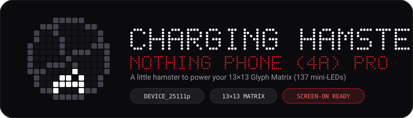

<p align="center">
  
</p>

A custom Glyph Matrix toy and home/lock screen widget built specifically for the **Nothing Phone (4a) Pro** (`13×13` grid, 137 mini-LEDs).

Most third-party Glyph toys target the larger `25×25` matrix on the Phone (3), which means they either refuse to load on the 4a Pro or crop the animation. Every frame in this project is hand-drawn for the 4a Pro's circular 137-LED mask (`[5, 9, 11, 11, 13, 13, 13, 13, 13, 11, 11, 9, 5]`), and the app can keep the matrix alive even while your screen is unlocked.

<br/>

<p align="center">
  
</p>

| State | Trigger | What happens on the 13×13 matrix |
| :--- | :--- | :--- |
| **Sleeping** | Idle / unplugged | The hamster curls up at the bottom of the wheel while single-pixel sleep particles drift up and off the top edge over a seamless 30-second loop. |
| **Running** | Charger connected | As soon as power is plugged in, the hamster wakes up and sprints forward, pushing the wheel spokes clockwise under its paws. |
| **Wheel Spin Stop** | Charger unplugged | When you unplug the cable, momentum carries the hamster around the inside of the wheel for one full 360° turn before it settles back down to sleep. |
| **Dancing** | Music playing | When audio plays in a music app, the wheel stays still and the hamster bobs left and right to the beat with floating musical notes. Charging always takes priority over music. |

<br/>

<p align="center">
  
</p>

* **Stays on with the screen** — standard AOD toys on Nothing OS turn off the moment you wake the display. This app bridges `HamsterToyService` (`setMatrixFrame`) and `setAppMatrixFrame` so the animation never cuts out when you unlock your phone.
* **Smart YouTube & video filter** — checks active `MediaSession` package names so the hamster dances to Spotify, YouTube Music, Apple Music, or Yandex Music, but stays asleep when you're watching regular YouTube, TikTok, Twitch, or video players. You can also exclude any installed app from the settings card.
* **Zero notification clutter** — runs silently through the bound Glyph Toy service without sitting in your notification shade.
* **Matching 13×13 Widget** — includes a circular home/lock screen widget that mirrors whatever the hamster is doing on the back of the phone.

<br/>

<p align="center">
  
</p>

### Install from Releases
1. Grab the latest `HamsterWheel-Nothing4aPro-v*.apk` from the [**Releases**](../../releases) page and install it.
2. Open **Charging Hamster** and tap **Edit in Glyph settings** (or go to *Settings → Glyph Interface → Always-on Glyph Toy*) and select **Charging Hamster**.
3. Tap **Grant media access** inside the app if you want it to filter out YouTube and custom excluded apps during music playback.

### Build from source
Requires JDK 17 and Android SDK 34. The Gradle script automatically downloads the official `glyph-matrix-sdk-2.0.aar` from Nothing's repository into `app/libs/` before compiling:

```bash
./gradlew assembleDebug
```
